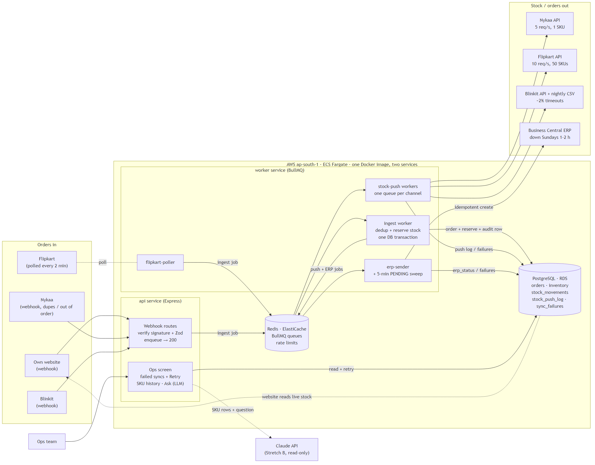

# Order & Inventory Sync Service: Design

**Author:** Varun Seemar · **Stack:** Node.js (Express) · PostgreSQL · Redis (BullMQ) · AWS

## 0. Summary

One Node.js codebase deployed as two processes (**api** and **worker**), with **PostgreSQL as the
only source of truth for stock**. Every order reserves stock with one atomic SQL `UPDATE`, so the
database cannot oversell. Stock changes go out through **one BullMQ queue per channel**, each with
its own rate limit, so one slow channel never blocks the others. Confirmed orders are marked
`erp_status = PENDING` in the same transaction and retried until the ERP accepts them.

Peak load is 300 orders/min ≈ **5 orders/sec**, which is small for Postgres. The real problems are
correctness (last unit, duplicates, out-of-order events) and channel limits.

---

## 1. Architecture



| Component | Runs where | Does what |
|---|---|---|
| **api** (Express) | ECS Fargate, 2 tasks behind ALB | Webhooks (verify signature, Zod, enqueue, return 200), ops screen, website stock API |
| **worker** (BullMQ) | ECS Fargate, 2 tasks, autoscale on CPU/queue size | `ingest`, `flipkart-poller`, `stock-push-*` (one per channel), `erp-sender`, crons |
| **PostgreSQL** | RDS db.t4g.medium | Orders, inventory, audit trail, push log, failures |
| **Redis** | ElastiCache t4g.small | BullMQ queues and rate limits only, never stock |

Same repo and Docker image for both services. Each channel is one file in `src/channels/`
implementing `normalizeOrder(raw)`, `pushStock(items)` and, for Flipkart, `fetchOrders(since)`.

---

## 2. Data model

`available = on_hand − reserved` (reserved = sold, not yet shipped).

| Table | Key columns | Constraints / notes |
|---|---|---|
| `orders` | `id` (uuid), `channel`, `external_order_id`, `status` (RESERVED / REJECTED_OOS / CANCELLED / SHIPPED / RETURNED), `erp_status` (PENDING / SENT / FAILED), `event_time`, `raw_payload` | **`UNIQUE (channel, external_order_id)`** |
| `order_items` | `order_id`, `sku`, `qty`, `unit_price` | FK → orders |
| `inventory` | `sku` (PK), `on_hand`, `reserved` | **`CHECK (reserved >= 0 AND reserved <= on_hand)`** |
| `stock_movements` | `sku`, `change_on_hand`, `change_reserved`, `reason` (RESERVE / RELEASE / SHIP / RESTOCK / ADJUST), `order_id`, `user_id`, `available_after`, `created_at` | Append-only. **The audit trail.** |
| `stock_push_log` | `channel`, `sku`, `qty_pushed`, `status`, `error`, `pushed_at` | What each channel was told and when. Kept 90 days. |
| `sync_failures` | `type` (ERP / NYKAA / FLIPKART / BLINKIT), `reference`, `error`, `attempts`, `status` | Backs the ops "failed syncs" screen |

**No duplicate orders:** `INSERT ... ON CONFLICT (channel, external_order_id) DO NOTHING`, so a
repeated webhook or poll overlap is a no-op. In the ERP our order `id` is the **External Document
No.**, checked before creating.

**Audit:** "why did stock change, and when?" =
`SELECT * FROM stock_movements WHERE sku = $1 ORDER BY created_at`, shown as a SKU history page.

---

## 3. Order ingestion

- **Webhooks** (website, Nykaa, Blinkit): verify signature → Zod → add `ingest` job → `200`. No
  business logic in the request. If enqueue fails we return `500` and the channel re-sends.
- **Flipkart polling:** repeatable job every 2 min, fetching orders updated since
  `last_polled_at − 30s`. The overlap avoids gaps; the duplicates it creates are dropped by the unique key.
- **Out of order:** status only moves forward (`RESERVED → SHIPPED → RETURNED` or `RESERVED →
  CANCELLED`); backward events are ignored. A **cancel before create** inserts the order as
  `CANCELLED` with no reservation, so the late create hits `ON CONFLICT` and does nothing. Events
  for the same order lock the order row (`SELECT ... FOR UPDATE`).
- **Stock lifecycle:** order → `reserved + qty`; cancel → `reserved − qty`; shipped →
  `on_hand − qty, reserved − qty`; return received → `on_hand + qty`. Each is a `stock_movements`
  row and triggers a push, so cancelled/returned stock goes back on sale automatically.
- **Channel down:** separate routes and queues per channel. A silent webhook source raises an alert
  (section 7); the Flipkart poller resumes from `last_polled_at`.

---

## 4. Inventory consistency: two channels sell the last unit in the same second

`MRS-LIP-104`: `on_hand = 10, reserved = 9` (available 1). A Nykaa order and a website order for
1 unit are picked up by two ingest workers at the same time.

1. Both start a transaction and insert their order row.
2. Both run:
   ```sql
   UPDATE inventory SET reserved = reserved + 1
   WHERE sku = 'MRS-LIP-104' AND on_hand - reserved >= 1;
   ```
3. **A (Nykaa)** gets the row lock: `10 − 9 >= 1` → updated, `reserved = 10`.
4. **B (website)** waits on the lock.
5. A writes its `stock_movements` row, sets `RESERVED` + `erp_status = PENDING`, **commits**.
6. B gets the lock; Postgres **re-checks the WHERE on the new row**: `10 − 10 >= 1` is false → **0 rows**.
7. B rolls back, saves its order as `REJECTED_OOS`, asks the channel to cancel, and queues an
   urgent **push of 0** to all channels.

Exactly one order wins; stock never goes negative, and the `CHECK` constraint backs this up.
Multi-item orders lock SKUs **in sorted order** to avoid deadlocks.
Pseudo-code: [pseudocode/reserve_stock.md](pseudocode/reserve_stock.md).

**Where oversells really come from:** a channel showing stock we no longer have (Flipkart orders
arrive up to 2 min late). So:

| Rule | Value |
|---|---|
| Website / Nykaa show | `available` |
| Flipkart / Blinkit show | `available − 2` (min 0) |
| When `available <= 5` | Push **0** to Flipkart and Blinkit; last units sell only on website + Nykaa |

**vs the 0.5% target:** sale day ≈ 80,000 orders → 400 rejections allowed. Rejections only happen
on the last units of a SKU on the fast channels; if 200 SKUs sell out and each loses ~1 order,
that's ~200 (≈0.25%). Thresholds are config, so they can be raised for a sale.

---

## 5. Stock push within 60 seconds

Pushes always send the **absolute quantity**, so retries are safe, and the worker reads the
**current** quantity when the job runs, so it always sends the latest value.

| Channel | Limit | How | Capacity |
|---|---|---|---|
| Website | none | Reads our stock API live | instant |
| Nykaa | 5 req/s, 1 SKU | Queue with limiter `{max: 5, duration: 1000}`, `jobId = nykaa:<sku>` | 300 SKUs/min |
| Flipkart | 10 req/s, 50 SKUs | Changed SKUs collected in a Redis set; job every 15 s sends batches of 50 at 8 req/s | 1,200 SKUs ≈ 3 s |
| Blinkit | ~2% timeouts | API on every change (5 s timeout, retry) + **nightly full CSV** as reset | — |

**Merging:** `jobId = channel:sku` means a SKU already waiting in the queue isn't added again, so
10 quick sales of a bestseller become **one** call. **Sale maths:** ~450 item changes/min, but
bestsellers repeat, so ~100–250 distinct SKUs/min. That fits Nykaa's 300/min, the tightest limit.
SKUs with `available <= 10` and "push 0" jobs get **higher priority**, so near-zero SKUs go first.
On a Flipkart **429** we wait for `Retry-After`; only the Flipkart queue slows down.

---

## 6. Failure handling

| Case | Handling |
|---|---|
| **Channel push fails** | 5 attempts, exponential backoff (10 s, 20 s, 40 s…), then a `sync_failures` row |
| **ERP Sunday downtime** | Order is already in Postgres as `PENDING`, so it can't be lost. Network/5xx errors retry with backoff capped at 15 min and never give up; a 5-min cron re-queues anything still `PENDING`. 2 h ≈ 700 orders, drained in minutes. Only 4xx (bad data) goes to `sync_failures`. |
| **ERP exactly once** | Look up by External Document No. before creating; if found, mark `SENT`. A timeout + retry can't duplicate. |
| **Blinkit timeouts** | 5 s timeout, up to 5 retries (safe: absolute qty). Nightly CSV fixes anything missed. |
| **Keeps failing** | Lands in `sync_failures`, never blocks the queue. Ops screen lists them with **Retry** (re-adds the job) and **Mark resolved**. |
| **Redis down** | Webhooks return 500 (channels retry), pushes pause. Orders in Postgres are safe; the ERP cron re-queues on recovery. |

---

## 7. Observability: day-one alerts (CloudWatch)

| Metric | Alert when |
|---|---|
| Out-of-stock rejections as % of orders | > 0.3% in an hour |
| Push lag per channel (change → successful push) | p95 > 60 s for 5 min |
| ERP pending orders: age of oldest | > 15 min outside the Sunday window |
| New `sync_failures` rows | > 0 in 15 min |
| Minutes since last order per channel | > 30 min in daytime |

---

## 8. Left out of v1

| Left out | Why |
|---|---|
| Multi-warehouse | One warehouse today; `warehouse_id` can be added later |
| Forecast-based per-channel allocation | The fixed buffer rule is enough for 0.5%; tune after the first sale |
| Price/catalogue sync, returns quality check | Not in requirements; ops can fix stock with an ADJUST movement |
| Kafka / microservices | Not needed at 5 orders/s with 3 devs and 6 weeks |
| Stretch B (LLM) | Designed below; built after v1 (~3–4 dev days) |

**6 weeks:** W1 DB + reservation · W2 website + Nykaa · W3 Flipkart + Blinkit · W4 ERP + retries ·
W5 ops screen + alerts · W6 load test at 300 orders/min.

---

## 9. Stretch B: "Why did SKU X oversell yesterday?"

An oversell for us = orders `REJECTED_OOS` because a channel still showed stock we didn't have.

**How:** ops pick a SKU and date and type a question. The backend runs **fixed, read-only SQL** for
that SKU and day and sends the result to Claude (Opus 5.5) in **one API call**: "explain using only this data".

**Data read:** `stock_movements`, `REJECTED_OOS` orders, `stock_push_log` (incl. failed pushes),
`sync_failures`, plus a SQL-computed summary (opening stock, sales per channel, time stock hit 0,
last successful push per channel). **No customer data.**

**Stopping it making things up:** (1) it only gets our rows and must say "not enough data" if they
don't explain it; (2) all numbers come from SQL; (3) every claim cites a row id (e.g. "push #8801
failed with 429") and the backend checks each id was in the data, marking the answer **unverified**
if not; (4) raw rows are shown under the answer; (5) read-only.

**Cost:** ~10k input + ~1.5k output tokens at $4 / $20 per million ≈ **$0.07 (~₹6) per question**;
20/day ≈ **₹3,500/month**. Capped at 50 questions/day, 500 rows each; repeat answers cached.

---

## 10. Assumptions

- Webhooks are HMAC-signed and re-sent by the channel on non-2xx.
- Channel stock APIs accept an absolute quantity. SKU codes are the same on all channels.
- Flipkart's order API filters by `updated_since`.
- Blinkit's API can take ~2 req/s; if not, we use it only for SKUs with `available <= 10` and the CSV for the rest.
- Business Central can look up an order by External Document No.
- The ERP/warehouse tells us when an order ships and when a return arrives.
- "Confirmed order" = stock reserved. Cancellations after ERP send are also sent to the ERP.
- Returns are sellable without a quality check. INR only; prices not synced.
- Rate limits are per seller account. The ops screen is internal, behind a login.

---

## 11. Trade-offs

| Decision | Chose | Rejected | Why |
|---|---|---|---|
| Stock source of truth | Postgres conditional `UPDATE` | Redis counter (Lua); optimistic locking + retry | Same transaction as order and audit row; one source of truth. Optimistic retries pile up on hot SKUs. |
| Framework | Express + BullMQ + Zod | NestJS | Nest is built on Express and adds structure, not capability. I know Express well; a fixed folder layout + channel interface is enough structure here. |
| Architecture | One codebase, api + worker | Microservices | 3 devs, 6 weeks, ₹50k. Two processes already keep HTTP away from slow channel calls. |
| Queue | BullMQ on Redis | RabbitMQ / SQS | Redis is already in the stack; retries, backoff, rate limits, priority and repeatable jobs are built in. |
| ERP delivery | `erp_status` in the order transaction + worker + sweep cron | Calling ERP inline | ERP is down every Sunday; orders must be accepted now and sent later. |
| Edge oversells | Buffer + "push 0 at ≤5" on slow channels | No buffer | Flipkart's 2-min lag would cause rejections on every sold-out SKU. Costs a few unsold units. |

---

## 12. Budget (approx.)

RDS ~₹7k · Redis ~₹3k · Fargate ~₹9–12k · ALB + NAT ~₹6k · CloudWatch/S3 ~₹3k · Claude API
(capped) ~₹3–9k → **~₹31–40k/month**, under ₹50k. RDS is single-AZ with backups in v1; Multi-AZ
(~+₹7k) is the first upgrade.

---

**AI usage:** Used Claude as a brainstorming partner on the key design calls (Postgres vs Redis for
stock, Express vs NestJS, the oversell buffer rule, Stretch A vs B), to check the rate-limit and cost
maths, and to help draft and format this doc. I weighed the options and made the final call on each.
